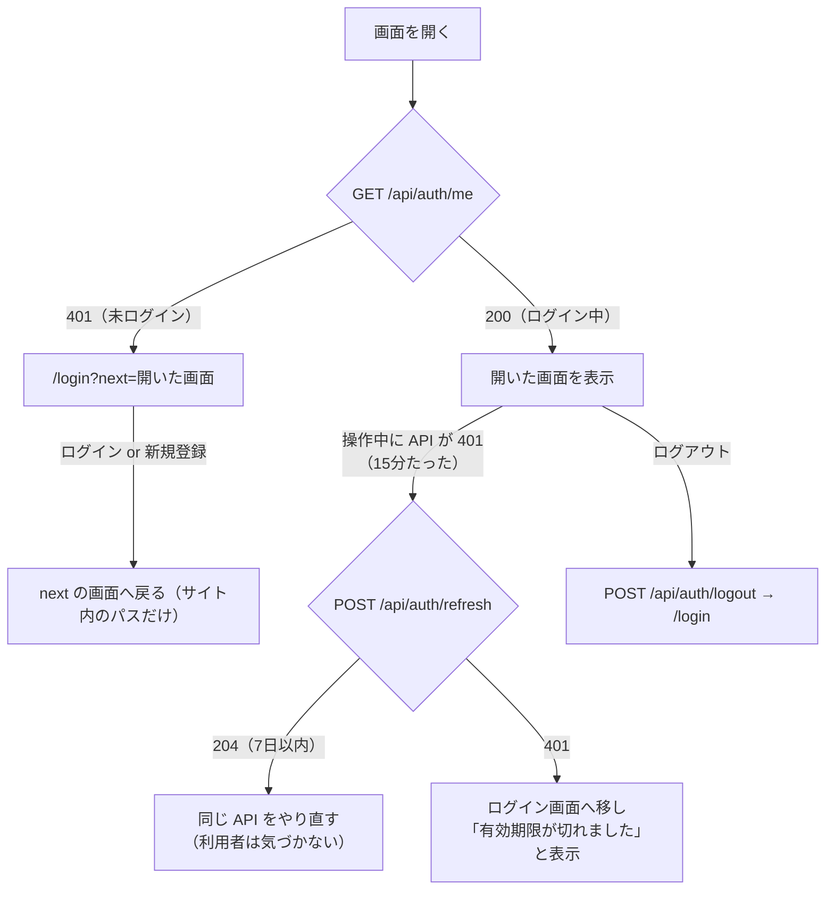

# RaiseLine 認証機能 定義書

2026-10-30 作成。対象: バックエンド（`backend/`、Spring Boot）とフロントエンド（`frontend/`、React）。要件は [`requirements.md`](./requirements.md) の F-01・F-15 と「6. 非機能要件」。

## 1. 概要

**ひとことで言うと：** メールアドレスとパスワードでログインすると、サーバーが2つのものを Cookie に入れて渡す。15分だけ使える署名入りの「入館証」（アクセストークン、JWT）と、7日間使える「入館証の引換券」（リフレッシュトークン）。ふだんのリクエストは入館証の署名を確かめるだけで本人と分かる。入館証が切れたら、引換券を新しい入館証と新しい引換券に取り替える（2026-11-14 追加）。

| 項目 | 方式 |
| --- | --- |
| ログインの仕組み | アクセストークン（JWT、HS256 で署名、15分）とリフレッシュトークン（推測できない乱数、7日）を Cookie に入れる。サーバー側セッションは使わない（2026-11-08 にセッションから変更、2026-11-14 にリフレッシュトークンを追加） |
| JWT の中身 | `sub`（ユーザー ID）、`sid`（どのログインか）、`ver`（JWT の世代）、`iat`（作った時刻）、`exp`（期限）だけ。メールアドレスなどは入れない（JWT の中身は誰でも読める） |
| すぐ無効にする | ログアウトはその端末のログイン（`sid`）を `revoked_sessions` に記録して断り、そのログインのリフレッシュトークンも消す。パスワード変更は `users.token_version` を進め、古い世代の JWT とリフレッシュトークンをすべて断る（2026-11-09 追加） |
| 署名の鍵 | 環境変数 `JWT_SECRET`（32バイト以上）。AWS は Terraform が64文字で作り、環境を作り直すたびに変わる。ローカルで空なら起動のたびに作る（再起動でログアウトになる） |
| Cookie | アクセストークンは `SNS_TOKEN`、`HttpOnly`、`SameSite=Lax`、`Path=/`、15分で消える。リフレッシュトークンは `SNS_REFRESH`、`HttpOnly`、`SameSite=Strict`、`Path=/api/auth`（作り直しとログアウトにだけ送る）、7日で消える。AWS（HTTPS）ではどちらも `Secure` を付ける（`SESSION_COOKIE_SECURE=true`） |
| パスワードの保存 | BCrypt でハッシュ化（元のパスワードは保存しない） |
| 画面と API | 同じオリジンで配信（開発中は Vite が `/api` を Spring Boot に中継、本番は Spring Boot が画面も配信）。CORS は使わない |
| ログイン状態の保持期間 | 最後の操作から7日。アクセストークンは操作しても延びず、15分で切れる。切れて 401 になると、画面が裏で `POST /api/auth/refresh` を呼んで作り直し、同じ API をやり直す（利用者は気づかない）。7日使わないとリフレッシュトークンも切れ、ログイン画面に戻る |

JWT を Cookie に入れた理由:

- 画面と API が同じオリジンなので、Cookie がそのまま使え、画面のコードを変えずに済む
- `HttpOnly` の Cookie は JavaScript から読めないので、もし XSS があっても JWT を盗まれにくい（localStorage に置くと読まれる）
- サーバーはふだんのリクエストでログインの状態を見に行かないので、再起動してもログインが続く（鍵が同じなら）

**リフレッシュトークンの仕組み（2026-11-14 追加）：**

| 項目 | 内容 |
| --- | --- |
| 持ち方 | `refresh_tokens` 表に SHA-256 のハッシュだけを置く（DB を見られても使えない）。どのログインか（`session_id`、アクセストークンの `sid` と同じ）、作ったときの `token_version`、期限、使った時刻を持つ（`V14__refresh_tokens.sql`） |
| 取り替え（ローテーション） | 使うたびに新しいものと取り替え、古いものは「使った」にする。新しいものの期限はそこから7日 |
| 使い回しの検知 | 使い終わったものが30秒以上たってからまた届いたら、盗まれて使われたとみなし、そのログインごと終える（リフレッシュトークンをすべて消し、`sid` を `revoked_sessions` に入れる）。本人と盗んだ人のどちらが本物か分からないため |
| 同時に作り直したとき | 2つのタブが同時に作り直すと、遅れた方は1つ前のものを送ってくる。30秒以内なら盗まれたとはみなさず、何も変えずに 204 を返す（Cookie はタブ同士で同じなので、届いた新しい Cookie でやり直せる）。同じタブの中では、画面が作り直しを1回にまとめる |
| 使えないもの | 無い、期限切れ、ログアウト済み、パスワード変更前（`token_version` が違う）、アカウントを消した（表の行も一緒に消える） → 401 と、Cookie を2つとも消す |
| 同時の取り替え・ログアウト | 取り替えるときは行をロックして読む（`SELECT … FOR UPDATE`）。同じトークンの取り替えやログアウトが同時に来ても、先の処理が終わった状態で判断する。MySQL がデッドロックで片方を取り消したときは、3回までやり直す（`CurrentUser.retryOnDeadlock`） |
| 掃除 | 期限を過ぎた行は、ログインのたびに消す |

**すぐ無効にする仕組み：** JWT だけでは、渡したものを期限前に取り消せない。そこで DB に2つだけ持つ（2026-11-09 追加）。

| 操作 | 仕組み | 効き目 |
| --- | --- | --- |
| ログアウト | ログインごとに `sid` を振り、作り直した JWT にも同じ `sid` を入れる。ログアウトすると `sid` を `revoked_sessions` に入れる | **その端末だけ**。作り直す前の古い JWT も含めて使えなくなる。ほかの端末はそのまま |
| パスワード変更 | `users.token_version` を1つ進める。JWT の `ver` が今の値と違えば断る | **すべての端末**。変えた本人には新しい世代の JWT を渡すので、本人だけは切れない |

`revoked_sessions` の行は、期限（記録してから15分）を過ぎたら消してよい（その `sid` の JWT はどれも期限切れになっている）。ログアウトのたびに古い行を消す。

## 2. 用語

| 用語 | 意味 |
| --- | --- |
| JWT | JSON Web Token。「ヘッダー.中身.署名」を `.` でつないだ文字列。中身を書き換えると署名が合わなくなるので、偽造できない |
| ユーザー名 | `@alice` の `alice` の部分。半角英数字と `_`、1〜15字。大文字・小文字は区別しない（`Alice` と `alice` は同じ人） |
| 表示名 | 画面に大きく出る名前。50字まで、後から変えられる |

## 3. 画面の流れ



## 4. バックエンド

### 4.1 API

| メソッド | パス | 内容 | 成功 | 主なエラー |
| --- | --- | --- | --- | --- |
| POST | `/api/auth/register` | 新規登録。ログインはしない | 201 と本人の情報 | 400 入力の形式、409 メール・ユーザー名の重複 |
| POST | `/api/auth/login` | ログイン。アクセストークンとリフレッシュトークンを作り Cookie で返す | 200 と本人の情報 | 401 メールかパスワードが違う、429 試行回数超え |
| POST | `/api/auth/refresh` | リフレッシュトークンを取り替え、アクセストークンも作り直す（2026-11-14 追加） | 204 と新しい Cookie 2つ（30秒以内の使い回しは Cookie なし） | 401 無い・期限切れ・使えない・使い回し |
| POST | `/api/auth/logout` | この端末のログアウト。そのログインを記録して期限前でも使えなくし、リフレッシュトークンも消す。期限0の空の Cookie でブラウザの Cookie も2つとも消す。アクセストークンが切れていても、リフレッシュトークンからログインを特定する | 204 | ― （未ログインでも 204） |
| GET | `/api/auth/me` | ログイン中の本人の情報 | 200 | 401 未ログイン・期限切れ |
| PUT | `/api/users/me` | メールアドレス・パスワードの変更。今のパスワードが必要 | 200 | 400 今のパスワードが違う、409 メールの重複 |
| DELETE | `/api/users/me` | アカウントの削除（F-17）。パスワードが必要。すべての端末でログアウトになる | 204 | 400 パスワードが違う、429 5分に5回を超えた |
| POST | `/api/auth/forgot-password` | パスワード再設定のリンクをメールで送る（F-18）。登録が無くても同じ応答 | 204 | 429 1つのアドレスにつき1時間に3回を超えた |
| POST | `/api/auth/reset-password` | リンクのトークンで新しいパスワードにする。すべての端末でログアウトになる | 204 | 400 リンクが違う・期限切れ・使用済み、パスワードの形式 |

「本人の情報」は `id, email, username, displayName, iconUpdatedAt, bio, createdAt`。パスワードのハッシュは返さない。メールアドレスは本人にだけ返し、他の人の情報（投稿者など）には入れない。

### 4.2 入力のルール

| 項目 | ルール | 検証する場所 |
| --- | --- | --- |
| メールアドレス | 必須、メールの形式、255字まで。前後の空白を取り、小文字にそろえて保存（`Alice@Example.com` と `alice@example.com` は同じ） | `UserDtos.RegisterRequest` / `AuthController` |
| パスワード | 8〜72字（BCrypt が扱えるのは72バイトまで。日本語などで72バイトを超える場合も弾く） | `UserDtos` / `PasswordEncoderConfig` |
| ユーザー名 | 半角英数字と `_`、1〜15字。重複不可（大文字・小文字は区別しない）。変更不可 | `UserDtos`、DB の一意制約 |
| 表示名 | 必須、50字まで（Java の文字数で数える）。前後の空白を取る | `UserDtos` |

### 4.3 ログインしているかの確認（`CurrentUser.require`）

ログインが必要な API は、最初に `CurrentUser.require()` を呼ぶ。

1. Cookie `SNS_TOKEN` が無い → **401「ログインが必要です」**
2. JWT を確かめる（`TokenService.verify`）。形が壊れている、方式が HS256 でない（`none` など）、署名が合わない、期限切れ → **401「ログインの有効期限が切れました。もう一度ログインしてください」**
3. DB を見る。ユーザーがいない（アカウントを消した）、`ver` が `users.token_version` と違う（パスワードを変えた）、`sid` が `revoked_sessions` にある（ログアウトした）→ 2と同じ **401**
4. どれでもなければ `sub`（ユーザー ID）を返す

`LoginInterceptor` は、ログインが必要な API の前に `require()` を呼ぶ。アクセストークンは操作しても作り直さない（作り直すのは `POST /api/auth/refresh` だけ）。作り直しても `sid` と `ver` は変えない。

### 4.4 安全対策

| 対策 | 内容 | 場所 |
| --- | --- | --- |
| アカウントの大量作成 | 新規登録は1つの IP から1時間に5回まで（AWS）。超えたら 429。IP は CloudFront が足した `X-Forwarded-For` の最後の値で見る（前の部分は利用者が書き換えられる）。IP を変えられる相手は止められない | `AuthController`、`ClientIp` |
| IP を変えた大量登録 | 登録後、確認メールのリンクを開くまでログインできない。リンクはトークンのハッシュだけを DB に置き、24時間で切れ、1回だけ使える。確認されなかった登録は24時間後に消す | `EmailVerificationService` |
| 確認メールの悪用 | 再送は1つのアドレスにつき1時間に3回、メールアドレスの変更は1ユーザーにつき1時間に3回まで。再送は登録の有無が分からないよう、常に 204 を返す | `AuthController`・`UserController` |
| 他人のメールアドレスへの変更 | 新しいアドレスに届くリンクを開くまで、メールアドレスは変わらない | `UserController.updateMe` |
| パスワードの総当たり | 同じメールアドレスへのログインは5分間に10回まで。超えたら 429。IP ではなくメールアドレスで数える（同じ回線の人を巻き込まないため） | `AuthController`、`RateLimiter` |
| 登録有無の推測 | 未登録のメールアドレスでもダミーのハッシュで BCrypt の照合を1回行い、応答時間をそろえる。エラー文も「メールアドレスまたはパスワードが正しくありません」で共通 | `AuthController.login` |
| JWT の偽造・改ざん | HS256 の署名を確かめる。ヘッダーの方式が HS256 でないもの（`alg: none` など）は署名を見る前に断る。鍵は32バイト以上でないと起動しない | `TokenService` |
| セッション固定攻撃 | ログインのたびに新しい JWT を作るので、ログイン前の値を使い回させることはできない | `AuthController.login` |
| XSS で Cookie を盗まれる | Cookie は `HttpOnly`（JavaScript から読めない）。画面は投稿を文字として出し、HTML として解釈しない | `CurrentUser`、React |
| リフレッシュトークンを盗まれる | 使うたびに取り替え、古いものがまた使われたらそのログインごと終える。Cookie は `Path=/api/auth` で、ふだんの API には送らない | `RefreshTokens` |
| CSRF（他サイトから勝手に操作させる） | Cookie は `SameSite=Lax`（リフレッシュトークンは `Strict`）なので、他のサイトからの POST・PUT・PATCH・DELETE には付かない。CORS も localhost と指定したオリジン（AWS は CloudFront の URL）だけ | `CurrentUser`、`WebConfig` |
| 同時登録 | 存在チェックと保存の間に同じメール・ユーザー名が入っても、DB の一意制約で弾いて 409 を返す | `AuthController.register` |
| 他人のデータ | 他人の投稿・リプライの削除は 403 ではなく 404（存在を教えない） | `PostController`、`ReplyController` |

### 4.5 エラーの形

すべて同じ JSON で返す（`GlobalExceptionHandler`）。

```json
{ "timestamp": "2026-10-30T03:08:49Z", "status": 401, "message": "ログインが必要です" }
```

## 5. フロントエンド

### 5.1 ログイン状態の持ち方（`src/auth.tsx`）

- Cookie は `HttpOnly` で JavaScript から読めないので、**起動時に `GET /api/auth/me` を呼んで**ログイン中かをサーバーに聞く。答えが返るまでは「読み込み中…」を出す
- 本人の情報は React の Context（`AuthProvider`）にだけ持つ。localStorage・sessionStorage には何も保存しない（端末に残るのはテーマの選択だけ）
- `useAuth()` で `me`（未ログインなら `null`）、`login`、`register`、`logout`、`updateMe` を使う

### 5.2 画面の守り方

| 仕組み | 内容 |
| --- | --- |
| `RequireAuth` | `/login` 以外の画面を包む。未ログインなら `/login?next=<開こうとした画面>` へ移す |
| 戻り先の確認（`safeNext`） | `next` は `/` で始まるサイト内のパスだけ許す。`//evil.example` や `/\evil.example`、`https://…` は `/` に置き換える（オープンリダイレクト対策） |
| ログイン済みで `/login` を開いた | すぐ `next`（無ければタイムライン）へ移す |

画面を守るのは見た目の都合で、**本当の守りはサーバー**（すべての API が `CurrentUser.require` で確かめる）。画面を書き換えられても、データは取れない。

### 5.3 API の呼び方（`src/api.ts`）

- `api()` を通して呼ぶ。`credentials: "same-origin"` で Cookie が付く
- 失敗したら `ApiError(status, message)` を投げ、画面はサーバーの日本語メッセージをそのまま出す
- **401 が返ったら、まず `POST /api/auth/refresh` で作り直し、成功すれば同じ API を1回だけやり直す**。同時に複数の API が 401 になっても、作り直しは1回にまとめる
- **作り直してもだめなら**（7日使わなかった・他の端末でのパスワード変更）、`AuthProvider` が `me` を `null` にし、`RequireAuth` がログイン画面へ移す。ログイン画面には「ログインの有効期限が切れました。もう一度ログインしてください」と出す
- ただし `/api/auth/*`（ログイン・登録）の 401 はパスワード違いなので、作り直しも期限切れ扱いもしない（`/api/auth/me` だけは作り直す）
- 画像（``）は `api()` を通らないので作り直さない。画面を開くと先に `api()` で一覧を読むので、そのとき作り直される
- サーバーにつながらないときは「サーバーに接続できません」

### 5.4 ログイン・新規登録画面（`/login`）

| 項目 | 内容 |
| --- | --- |
| タブ | 「ログイン」「新規登録」 |
| 送る前の確認 | サーバーと同じルール（4.2）を画面でも確かめ、分かるエラーはすぐ出す。最終的な判断はサーバー |
| 新規登録 | 登録 API のあと、続けてログイン API を呼ぶ（登録はログインを兼ねない） |
| エラー表示 | フォームの上に赤字。パスワード違いは「メールアドレスまたはパスワードが正しくありません」 |
| 入力補助 | `autocomplete` を付け、ブラウザのパスワード保存が使える |

### 5.5 ログアウト

ヘッダーの「ログアウト」→ `POST /api/auth/logout` → `/login`（戻り先の `next` は付けない。次にログインした人がタイムラインから始まるように）。サーバーに届かなくても、画面上はログアウトする。

### 5.6 設定画面でのアカウント変更（`/settings`）

| フォーム | 送る API | 備考 |
| --- | --- | --- |
| メールアドレス | `PUT /api/users/me`（`email`、`currentPassword`） | 本人確認のため今のパスワードが必要 |
| パスワード | `PUT /api/users/me`（`currentPassword`、`newPassword`） | 確認用の再入力が一致しないと送らない。変えると他の端末は次の操作でログアウトされる |

## 6. テスト

| テスト | 確かめていること |
| --- | --- |
| `AuthControllerTest`（バックエンド） | 登録・重複・入力形式、ログイン成功・失敗、回数制限、Cookie の属性（HttpOnly・SameSite・アクセストークン15分・リフレッシュトークン7日と Path）、ログアウトで Cookie が消え、控えた JWT も使えない、期限を過ぎたログアウトの記録は消える、壊れた・改ざん・`alg: none`・別の鍵の JWT を断る、アクセストークンは操作しても延びず15分で切れる、パスワード変更で他の端末が切れ本人は続く、短すぎる鍵で起動しない |
| `RefreshTokenTest`（バックエンド、10件） | 切れたアクセストークンを作り直せ、リフレッシュトークンも新しくなる、使えば最後の利用から7日続く、7日使わないと切れて Cookie も消える、古いものを30秒後に使うとそのログインごと終わる（ほかの端末はそのまま）、30秒以内の同時の作り直しは見逃す、アクセストークンが切れていてもログアウトでリフレッシュトークンも終わる、ログアウトはその端末だけ、パスワード変更・アカウント削除でほかの端末のリフレッシュトークンも使えない |
| `RefreshTokenConcurrencyTest`（バックエンド、2件） | 同じトークンの同時の取り替えで、新しいトークンを受け取るのは片方だけ。取り替えとログアウトが同時でも、ログインが残らない |
| `DeadlockRetryTest`（バックエンド、2件） | デッドロックで取り消された処理をやり直し、3回でやめる |
| `api.test.ts`（フロント、4件） | 401 で作り直して同じ API をやり直す、同時の 401 でも作り直しは1回、作り直せなければログイン切れ扱い、ログインの 401 では作り直さない |
| `account.spec.ts`（E2E） | パスワードを変えると、ほかの端末のログインが切れ、新しいパスワードだけで入れる |
| `auth.test.tsx`（フロント、7件） | 未ログインならログイン画面へ移し戻り先を覚える、自分でログアウトしたら戻り先を付けない、ログイン後に戻る、パスワード違いの表示、新規登録の入力チェックと自動ログイン、ログイン中の 401 でログイン画面へ戻り理由を出す |
| `text.test.ts`（フロント） | `safeNext` が外部サイトへの戻り先を弾く |

## 7. 今後（スコープ外）

- ログイン中の端末の一覧と、選んだ端末のログアウト
