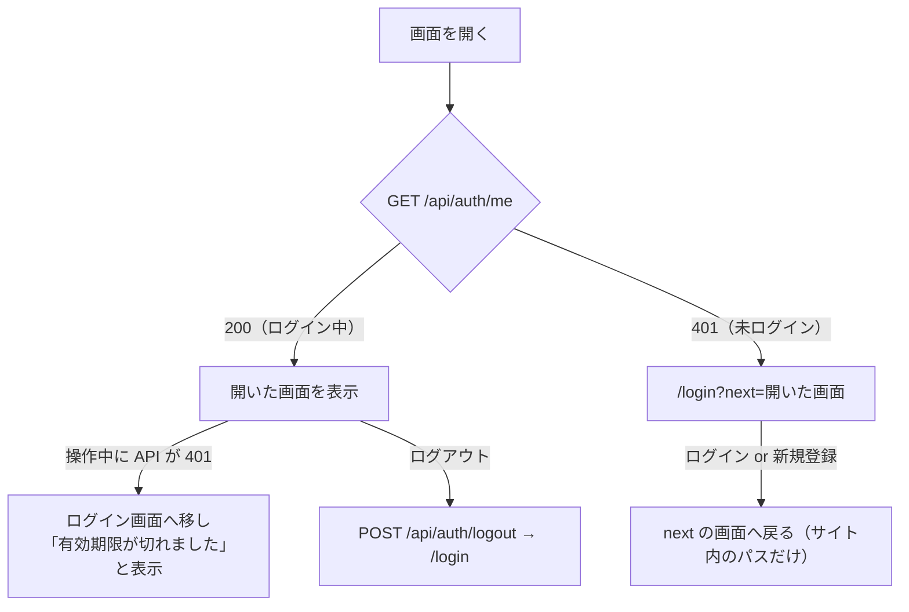

# RaiseLine 認証機能 定義書

2026-10-30 作成。対象: バックエンド（`backend/`、Spring Boot）とフロントエンド（`frontend/`、React）。要件は [`requirements.md`](./requirements.md) の F-01・F-15 と「6. 非機能要件」。

## 1. 概要

**ひとことで言うと：** メールアドレスとパスワードでログインすると、サーバーが「入館証」（セッション Cookie）を渡す。以後のリクエストはその Cookie だけで本人を確かめる。

| 項目 | 方式 |
| --- | --- |
| ログインの仕組み | サーバー側セッション（Tomcat の HttpSession）＋ Cookie。JWT は使わない |
| Cookie | 名前 `SNS_SESSION`、`HttpOnly`、`SameSite=Lax`。AWS で HTTPS にするときは `Secure` も付ける |
| パスワードの保存 | BCrypt でハッシュ化（元のパスワードは保存しない） |
| 画面と API | 同じオリジンで配信（開発中は Vite が `/api` を Spring Boot に中継、本番は Spring Boot が画面も配信）。CORS は使わない |
| ログイン状態の保持期間 | 最後の操作から30分（Tomcat の既定）。過ぎると次の操作で 401 になり、ログイン画面に戻る |

JWT ではなくセッションにした理由:

- 画面と API が同じオリジンなので、Cookie がそのまま使える
- `HttpOnly` の Cookie は JavaScript から読めないので、もし XSS があってもログイン情報を盗まれにくい（localStorage に JWT を置くと読まれる）
- パスワード変更・ログアウトで、サーバー側からすぐにログインを無効にできる

## 2. 用語

| 用語 | 意味 |
| --- | --- |
| セッション | サーバーが覚えている「この Cookie の持ち主は誰か」の記録。`userId` と、ログイン時のパスワードハッシュを入れる |
| ユーザー名 | `@alice` の `alice` の部分。半角英数字と `_`、1〜15字。大文字・小文字は区別しない（`Alice` と `alice` は同じ人） |
| 表示名 | 画面に大きく出る名前。50字まで、後から変えられる |

## 3. 画面の流れ



## 4. バックエンド

### 4.1 API

| メソッド | パス | 内容 | 成功 | 主なエラー |
| --- | --- | --- | --- | --- |
| POST | `/api/auth/register` | 新規登録。ログインはしない | 201 と本人の情報 | 400 入力の形式、409 メール・ユーザー名の重複 |
| POST | `/api/auth/login` | ログイン。セッションを作り Cookie を返す | 200 と本人の情報 | 401 メールかパスワードが違う、429 試行回数超え |
| POST | `/api/auth/logout` | ログアウト。セッションを破棄 | 204 | ― （未ログインでも 204） |
| GET | `/api/auth/me` | ログイン中の本人の情報 | 200 | 401 未ログイン・期限切れ |
| PUT | `/api/users/me` | メールアドレス・パスワードの変更。今のパスワードが必要 | 200 | 400 今のパスワードが違う、409 メールの重複 |

「本人の情報」は `id, email, username, displayName, iconUpdatedAt, bio, createdAt`。パスワードのハッシュは返さない。メールアドレスは本人にだけ返し、他の人の情報（投稿者など）には入れない。

### 4.2 入力のルール

| 項目 | ルール | 検証する場所 |
| --- | --- | --- |
| メールアドレス | 必須、メールの形式、255字まで。前後の空白を取り、小文字にそろえて保存（`Alice@Example.com` と `alice@example.com` は同じ） | `UserDtos.RegisterRequest` / `AuthController` |
| パスワード | 8〜72字（BCrypt が扱えるのは72バイトまで。日本語などで72バイトを超える場合も弾く） | `UserDtos` / `PasswordEncoderConfig` |
| ユーザー名 | 半角英数字と `_`、1〜15字。重複不可（大文字・小文字は区別しない）。変更不可 | `UserDtos`、DB の一意制約 |
| 表示名 | 必須、50字まで（Java の文字数で数える）。前後の空白を取る | `UserDtos` |

### 4.3 ログインしているかの確認（`CurrentUser.require`）

ログインが必要な API は、最初に `CurrentUser.require()` を呼ぶ。

1. セッションが無い、または `userId` が入っていない → **401「ログインが必要です」**
2. セッションに入っている「ログイン時のパスワードハッシュ」と、DB の今のハッシュを比べる
3. 違う（＝ログイン後にパスワードが変わった）→ セッションを破棄して **401「ログインの有効期限が切れました」**
4. 同じ → `userId` を返す

これで、**パスワードを変えると、ほかの端末のログインは次の操作で切れる**。変えた本人の端末だけは、新しいハッシュでセッションを入れ直すので切れない。

### 4.4 安全対策

| 対策 | 内容 | 場所 |
| --- | --- | --- |
| パスワードの総当たり | 同じメールアドレスへのログインは5分間に10回まで。超えたら 429。IP ではなくメールアドレスで数える（同じ回線の人を巻き込まないため） | `AuthController`、`RateLimiter` |
| 登録有無の推測 | 未登録のメールアドレスでもダミーのハッシュで BCrypt の照合を1回行い、応答時間をそろえる。エラー文も「メールアドレスまたはパスワードが正しくありません」で共通 | `AuthController.login` |
| セッション固定攻撃 | ログイン成功時にセッション ID を作り直す（`changeSessionId`） | `AuthController.login` |
| XSS で Cookie を盗まれる | Cookie は `HttpOnly`（JavaScript から読めない）。画面は投稿を文字として出し、HTML として解釈しない | `application.yml`、React |
| CSRF（他サイトから勝手に操作させる） | Cookie は `SameSite=Lax` なので、他のサイトからの POST・PUT・PATCH・DELETE には付かない。CORS も localhost と指定したオリジンだけ | `application.yml`、`WebConfig` |
| 同時登録 | 存在チェックと保存の間に同じメール・ユーザー名が入っても、DB の一意制約で弾いて 409 を返す | `AuthController.register` |
| 他人のデータ | 他人の投稿・リプライの削除は 403 ではなく 404（存在を教えない） | `PostController`、`ReplyController` |

### 4.5 エラーの形

すべて同じ JSON で返す（`GlobalExceptionHandler`）。

```json
{ "timestamp": "2026-10-30T03:08:49Z", "status": 401, "message": "ログインが必要です" }
```

## 5. フロントエンド

### 5.1 ログイン状態の持ち方（`src/auth.tsx`）

- Cookie は `HttpOnly` で JavaScript から読めないので、**起動時に `GET /api/auth/me` を呼んで**ログイン中かをサーバーに聞く。答えが返るまでは「読み込み中…」を出す
- 本人の情報は React の Context（`AuthProvider`）にだけ持つ。localStorage・sessionStorage には何も保存しない（端末に残るのはテーマの選択だけ）
- `useAuth()` で `me`（未ログインなら `null`）、`login`、`register`、`logout`、`updateMe` を使う

### 5.2 画面の守り方

| 仕組み | 内容 |
| --- | --- |
| `RequireAuth` | `/login` 以外の画面を包む。未ログインなら `/login?next=<開こうとした画面>` へ移す |
| 戻り先の確認（`safeNext`） | `next` は `/` で始まるサイト内のパスだけ許す。`//evil.example` や `/\evil.example`、`https://…` は `/` に置き換える（オープンリダイレクト対策） |
| ログイン済みで `/login` を開いた | すぐ `next`（無ければタイムライン）へ移す |

画面を守るのは見た目の都合で、**本当の守りはサーバー**（すべての API が `CurrentUser.require` で確かめる）。画面を書き換えられても、データは取れない。

### 5.3 API の呼び方（`src/api.ts`）

- `api()` を通して呼ぶ。`credentials: "same-origin"` で Cookie が付く
- 失敗したら `ApiError(status, message)` を投げ、画面はサーバーの日本語メッセージをそのまま出す
- **ログイン中に 401 が返ったら**（期限切れ・他の端末でのパスワード変更）、`AuthProvider` が `me` を `null` にし、`RequireAuth` がログイン画面へ移す。ログイン画面には「ログインの有効期限が切れました。もう一度ログインしてください」と出す
- ただし `/api/auth/*`（ログイン・登録）の 401 はパスワード違いなので、期限切れ扱いにしない
- サーバーにつながらないときは「サーバーに接続できません」

### 5.4 ログイン・新規登録画面（`/login`）

| 項目 | 内容 |
| --- | --- |
| タブ | 「ログイン」「新規登録」 |
| 送る前の確認 | サーバーと同じルール（4.2）を画面でも確かめ、分かるエラーはすぐ出す。最終的な判断はサーバー |
| 新規登録 | 登録 API のあと、続けてログイン API を呼ぶ（登録はログインを兼ねない） |
| エラー表示 | フォームの上に赤字。パスワード違いは「メールアドレスまたはパスワードが正しくありません」 |
| 入力補助 | `autocomplete` を付け、ブラウザのパスワード保存が使える |

### 5.5 ログアウト

ヘッダーの「ログアウト」→ `POST /api/auth/logout` → `/login`。サーバーに届かなくても、画面上はログアウトする。

### 5.6 設定画面でのアカウント変更（`/settings`）

| フォーム | 送る API | 備考 |
| --- | --- | --- |
| メールアドレス | `PUT /api/users/me`（`email`、`currentPassword`） | 本人確認のため今のパスワードが必要 |
| パスワード | `PUT /api/users/me`（`currentPassword`、`newPassword`） | 確認用の再入力が一致しないと送らない。変えると他の端末は次の操作でログアウトされる |

## 6. テスト

| テスト | 確かめていること |
| --- | --- |
| `AuthControllerTest`（バックエンド、12件） | 登録・重複・入力形式、ログイン成功・失敗、回数制限、セッション固定対策、パスワード変更で他のセッションが切れる |
| `auth.test.tsx`（フロント、6件） | 未ログインならログイン画面へ移し戻り先を覚える、ログイン後に戻る、パスワード違いの表示、新規登録の入力チェックと自動ログイン、ログイン中の 401 でログイン画面へ戻り理由を出す |
| `text.test.ts`（フロント） | `safeNext` が外部サイトへの戻り先を弾く |

## 7. 今後（スコープ外）

- パスワードを忘れたときの再設定（メール送信が必要）
- メールアドレスの確認（確認メール）
- 「ログインしたままにする」（30分より長いセッション）
- 2段階認証
