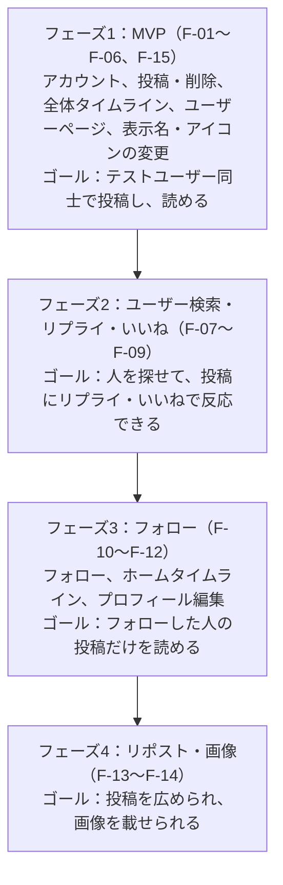

# RaiseLine（旧Twitter風SNS） 要件定義書

2026-10-28 作成、2026-10-30 更新（アプリ名を RaiseLine に決定。技術構成を React + Spring Boot + MySQL に変更。フェーズ2・3を前倒しで実装し、「コメント」を「リプライ」に改名）。実装済みの動きは [`spec.md`](./spec.md)、ログインの決まりは [`auth.md`](./auth.md)。初版の原本: [Claude Docs](https://claude.ai/artifact/X3N4ABdcbMwAHKcEgFkmhR)

## 1. 概要

学習用に、旧Twitter風のSNS（短い文章を投稿し、タイムラインで読む）を作る。最初の版は「投稿」と「タイムライン」だけで、ユーザー検索・リプライ・いいねはフェーズ2、フォローはフェーズ3で足す。

**ひとことで言うと：** 140文字の「つぶやき」を投稿して、みんなの投稿を新しい順に読めるアプリ。

| 項目 | 内容 |
| --- | --- |
| 目的 | SNSならではの仕組み（タイムライン、フォロー、いいね）を自分で作って理解する |
| 学習テーマ | 大量データの読み込み（ページ送り）、多対多の関係（フォロー）、重複の防止（いいねは1人1回）、件数の集計、画像のアップロード |
| 対象ユーザー | 自分と、動作確認用のテストユーザー数人。一般公開はしない |
| リポジトリ | `sns-app`（GitHub で公開） |
| 成功の目安 | 投稿が2秒以内にタイムラインに出る／フェーズごとに機能とテストが揃う |

## 2. 流用する既存資産

技術構成は **React + Spring Boot + MySQL** にする（2026-10-29 に Next.js + Rails から変更）。バックエンドはタスク管理アプリ、デプロイは収支管理アプリの使い慣れた部分を写して使い、SNS固有の部分の学習に時間を使う。

| 層 | 技術 |
| --- | --- |
| フロントエンド | React 19 + TypeScript + Vite + React Router。UI ライブラリ（Material UI など）は使わず CSS を自分で書く。ビルドした静的ファイルを Spring Boot から配信 |
| バックエンド | Java 25 + Spring Boot 4.1 + Maven（Spring Data JPA、BCrypt） |
| データベース | MySQL 8.4（ローカルは Docker、AWS は RDS for MySQL の無料枠） |

| 既存アプリの仕組み | 流用元 | 扱い |
| --- | --- | --- |
| アカウント（登録・ログイン・パスワード変更・ログイン回数制限） | タスク管理アプリ | そのまま使う。登録時に「ユーザー名（@〜）」と「表示名」を追加 |
| エラー処理（共通のエラー応答） | タスク管理アプリ | そのまま |
| 画面と API を同じオリジンで配信する構成 | 収支管理アプリ | そのまま（React を Spring Boot に同梱） |
| テーマ切替、エラーバナー、スマホ幅対応 | 収支管理アプリ | そのまま |
| デプロイ（up/down/deploy.ps1、EC2 + RDS） | 収支管理アプリ | そのまま |
| 家計簿・カテゴリ・取引、カンバン画面 | ― | 使わない（投稿とタイムラインに作り替え） |

既存アプリを複製するのではなく、新しいリポジトリで一から作り、上の表の部品だけを持ち込む。

## 3. 機能要件

MVP（フェーズ1）は F-01〜F-06 と F-15（2026-10-30 に追加）。その後は「ユーザー検索・リプライ・いいね」→「フォロー」→「リポスト・画像」の順に足す。

| ID | 機能 | 内容 | フェーズ |
| --- | --- | --- | --- |
| F-01 | ユーザー登録・ログイン | メール・パスワードに加え、ユーザー名（半角英数字と_、1〜15字、重複不可）と表示名（50字まで）を登録 | 1 |
| F-02 | 投稿 | 1〜140文字のテキストを投稿。残り文字数を入力中に表示し、超えたらボタンを押せない | 1 |
| F-03 | 投稿の削除 | 自分の投稿だけ削除できる（確認あり）。編集はできない | 1 |
| F-04 | 全体タイムライン | 全ユーザーの投稿を新しい順に20件ずつ表示。一番下の「もっと見る」で続きを読み込む | 1 |
| F-05 | ユーザーページ | `/@ユーザー名` でその人の表示名・投稿数・投稿一覧を表示 | 1 |
| F-06 | 投稿日時の表示 | 「3分前」「5時間前」「10月28日」のように相対表示 | 1 |
| F-15 | ユーザー情報の変更 | 設定画面で表示名（50字まで）とアイコン画像（JPEG/PNG、1MBまで）を変更。アイコンを外すと表示名の頭文字の丸に戻る。メール・パスワードの変更も同じ画面 | 1 |
| F-07 | ユーザー検索 | ユーザー名・表示名の一部で検索し、結果を20件ずつ表示。結果からユーザーページへ移動 | 2 |
| F-08 | リプライ | 投稿へのリプライ（1〜140文字）。投稿の詳細ページに古い順で表示し、タイムラインの投稿にはリプライ数を表示。自分のリプライは削除可（2026-10-30 に「コメント」から名前を変更） | 2 |
| F-09 | いいね | 1人1投稿1回。もう一度押すと取り消し。件数を表示 | 2 |
| F-10 | フォロー | ユーザーページでフォロー/解除。フォロー数・フォロワー数とその一覧 | 3 |
| F-11 | ホームタイムライン | 自分＋フォロー中の人の投稿だけ。「ホーム / みんな」のタブで切替 | 3 |
| F-12 | プロフィール編集 | 自己紹介（160字まで）を F-15 の設定画面に足す | 3 |
| F-13 | リポスト | 他人の投稿を自分のフォロワーのタイムラインに流す（「○○さんがリポスト」と表示）。取り消し可 | 4 |
| F-14 | 画像の添付 | 1投稿に画像1枚まで（JPEG/PNG、5MBまで）。保存はローカルはディスク、AWSは S3 | 4 |

## 4. データ設計

MVP のテーブルは users・posts・user_icons の3つ。フェーズが進むごとに1〜2個ずつ足す。

| テーブル | 主な項目 | 制約・インデックス | フェーズ |
| --- | --- | --- | --- |
| users | email, password_digest, username, display_name, icon_updated_at（アイコンが無ければ null）, bio | email と username に一意制約。検索は部分一致（LIKE）で、1,000人規模なら十分速い | 1（bio は3） |
| user_icons | user_id, content_type, data（画像本体、1MBまで）, updated_at | user_id が主キー（1人1枚）。users と分けて、ユーザー一覧を読むたびに画像まで読まないようにする。小さい画像だけなので S3 を使わず DB に置く | 1 |
| posts | user_id, body（140字）, created_at | (created_at, id) と (user_id, created_at, id) にインデックス | 1 |
| replies | post_id, user_id, body（140字）, created_at | (post_id, id) にインデックス。投稿を消すとリプライも消える | 2 |
| likes | user_id, post_id | (user_id, post_id) に一意制約 | 2 |
| follows | follower_id, followee_id | (follower_id, followee_id) に一意制約。自分自身はフォロー不可 | 3 |
| reposts | user_id, post_id, created_at | (user_id, post_id) に一意制約 | 4 |
| posts（追加） | 画像のパス（ファイル本体はディスク / S3） | ― | 4 |

**設計のポイント（学習テーマ）**

- **ページ送りはカーソル方式：** 「もっと見る」は「最後に表示した投稿より古いもの」を取る（`?before=<id>`）。「21件目から」（OFFSET）だと、読んでいる間に新しい投稿が増えると同じ投稿が2回出るため
- **件数は後でキャッシュ：** まず COUNT で数え、フェーズ2でいいね数・リプライ数が重くなったら posts に likes_count・replies_count を持たせる（counter cache）
- **N+1 を避ける：** タイムラインで投稿ごとに投稿者を取りに行かず、JPA の `JOIN FETCH`（または `@EntityGraph`）でまとめて読む
- **重複は DB で防ぐ：** いいね・フォローの「1回だけ」は一意制約で守り、連打しても二重に入らないようにする

## 5. 画面・API一覧

MVP の画面はログイン、タイムライン、ユーザーページの3つ。投稿欄はタイムラインの一番上に置く。

### 画面

| 画面 | URL | 主な表示・操作 | フェーズ |
| --- | --- | --- | --- |
| ログイン/新規登録 | `/login` | メール・パスワード（登録時はユーザー名・表示名も） | 1 |
| タイムライン | `/` | 投稿欄（残り文字数）、投稿の一覧、「もっと見る」。フェーズ2でいいね・リプライ数、フェーズ3で「ホーム / みんな」タブ | 1 |
| ユーザーページ | `/@ユーザー名` | 表示名、投稿数、投稿一覧。フェーズ3でフォローボタンと自己紹介 | 1 |
| アカウント設定 | `/settings` | 表示名・アイコンの変更、メール・パスワード変更（既存を流用）。フェーズ3で自己紹介 | 1 |
| ユーザー検索 | `/search?q=…` | 検索欄と結果の一覧（表示名・@ユーザー名） | 2 |
| 投稿の詳細 | `/posts/{id}` | 投稿、いいね、リプライ欄とリプライ一覧 | 2 |
| フォロー/フォロワー一覧 | `/@ユーザー名/following` など | ユーザーの一覧 | 3 |

### API（MVP）

| メソッド | パス | 内容 |
| --- | --- | --- |
| POST | `/api/auth/register`、`/login`、`/logout` | 既存を流用。register に username / display_name を追加 |
| GET | `/api/timeline?before=<投稿id>` | 全体タイムライン。20件と「続きがあるか」を返す |
| POST | `/api/posts` | 投稿する |
| DELETE | `/api/posts/{id}` | 削除。他人の投稿は 404 |
| GET | `/api/users/{username}` | プロフィールと投稿数 |
| GET | `/api/users/{username}/posts?before=<投稿id>` | その人の投稿一覧 |
| PATCH | `/api/me/profile` | 表示名の変更 |
| PUT / DELETE | `/api/me/icon` | アイコンの登録・変更（multipart）/ 外す |
| GET | `/api/users/{username}/icon` | アイコン画像。投稿やプロフィールの応答には、アイコンの有無と更新時刻だけを入れる（キャッシュが古くならないよう URL に `?v=<更新時刻>` をつける） |

フェーズ2で `GET /api/users?q=…`（検索）、`GET /api/posts/{id}`、`GET/POST /api/posts/{id}/replies`、`DELETE /api/replies/{id}`、`POST/DELETE /api/posts/{id}/like` を足す。フェーズ3以降は `POST/DELETE /api/users/{username}/follow`、`GET /api/timeline/home`、`POST/DELETE /api/posts/{id}/repost`。

## 6. 非機能要件

基本は収支管理アプリと同じ水準にする。SNS なので「他人の書いた文章を安全に表示すること」と「投稿が増えても遅くならないこと」を重く見る。

| 区分 | 要件 |
| --- | --- |
| 文字数 | 140字は「見た目の1文字」で数える（絵文字も 1 字）。画面とサーバーで同じ数え方にし、サーバー側でも検証して 400 を返す |
| 安全な表示 | 投稿は文字として表示し、HTML として解釈しない（XSS 対策。React の通常の表示で守られるので、`dangerouslySetInnerHTML` は使わない）。改行はそのまま出す |
| 連投対策 | 1ユーザー1分間に10投稿まで。超えたら 429 を返す |
| 性能 | 投稿10万件・ユーザー1,000人のテストデータで、タイムラインの1ページが 300ms 以内。既存の性能テスト（perf.ps1）にタイムラインのシナリオを足して測る |
| セキュリティ | 既存と同じ（パスワードのハッシュ化、Cookie セッション、ログイン回数制限）。他人の投稿の削除は 404 |
| 公開範囲 | 学習用なので、AWS に置くときも必要なときだけ起動し（up/down.ps1）、URL は広く共有しない |
| 対応環境 | PC の Chrome とスマホ幅 |
| テスト | 各 API のリクエストテスト、140字の境界値（140字は OK、141字は NG、絵文字を含む場合）、「もっと見る」で投稿が重複も欠落もしないこと、他人の投稿・リプライを消せないこと、いいねを連打しても二重に入らないこと |

## 7. 開発ステップとスコープ外

4段階で作り、各フェーズはゴールを満たしてから次へ進む。フェーズ1だけで SNS として触れる状態になる。

フェーズ1の作業は「新リポジトリ作成 → Spring Boot（users・posts、API、テスト）→ 画面のプロトタイプ → React の画面 → EC2 へデプロイ」の順。細かい手順は [`plan.md`](./plan.md) にまとめる。

**スコープ外（今回はやらない）**

- ダイレクトメッセージ（DM）
- 通知（いいねされた、フォローされた）と、新着の自動表示（リアルタイム更新）
- ハッシュタグ、トレンド、おすすめ表示
- 鍵アカウント、ブロック・ミュート、通報
- 投稿の編集
- 一般公開に向けた運用（利用規約、モデレーション）
